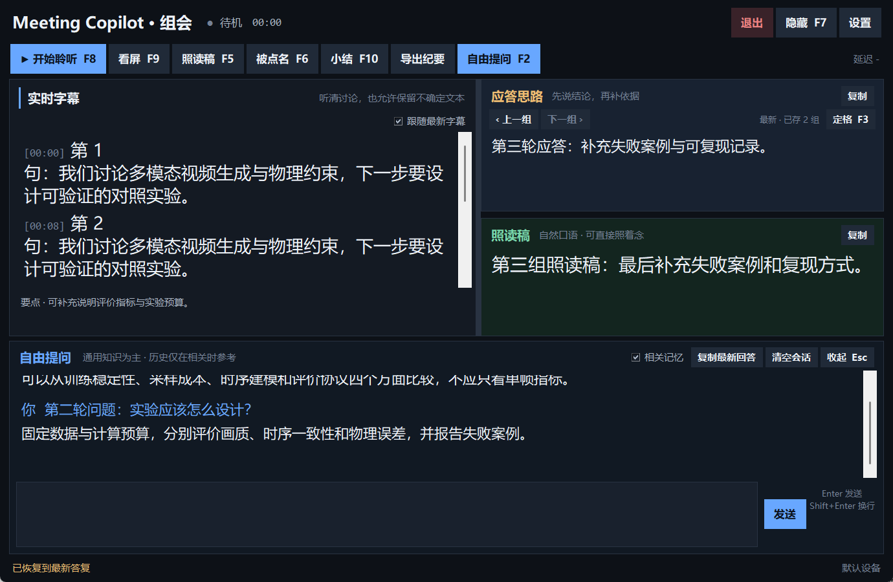

# Meeting Copilot

面向**研究组会与面试练习**的 Windows 桌面实时助手：本地语音转写、屏幕理解、应答思路、自然照读稿和连续自由提问，集中在同一个可缩放窗口中。

核心原则：**大模型负责思考，知识库只作为可选的过往记忆。** 不强制套用旧材料，不把回答限制在预先写好的背景里。



## 功能

- **组会／面试双场景**：设置中即时切换，也可用命令行指定；提示词和导出文件名随场景变化。
- **本地实时字幕**：通过 WASAPI 回环采集电脑正在播放的声音，使用 faster-whisper 在本机识别；耳机播放也可采集。
- **应答与照读稿分离**：先看 1～3 条思路，再按需要生成自然、可直接表达的一段话。
- **连续自由提问**：多行输入、保留问答历史，可使用与主模型不同的 provider/model。
- **屏幕理解**：解读当前页面、公式和图表；视觉服务不可用时降级到本地 OCR。
- **可选历史记忆**：把自己的 Markdown、TXT、DOCX、PPTX、PDF 建成本地 BM25 索引，只在相关时检索。
- **真正可调整的桌面窗口**：原生标题栏、拖动缩放、系统最大化、左右分栏拖动、界面字体缩放。
- **本地纪要**：导出转写 JSON 与 Markdown 纪要；默认不保存整场原始音频。

## 使用边界

请仅在获得会议参与者同意、遵守所在机构规定和适用法律的场景中使用。面试模式适合模拟面试、复盘和经明确允许的辅助；不要用于违反面试规则、冒充他人或捏造经历。

语音、屏幕和材料可能包含敏感信息。本地转写不等于整个流程都在本地：启用云端 LLM 或视觉模型时，相关文本或截图会发送给你配置的提供商。使用前请确认其数据政策。

## 环境要求

- Windows 10／11
- Python 3.14（当前开发环境）
- 可正常播放声音的输出设备
- 一个或多个 OpenAI 兼容 API；不使用云端功能时仍可单独运行本地转写

## Windows 免安装版

从 [Releases](https://github.com/H66e/meeting-copilot/releases) 下载 Windows x64 ZIP，解压后双击 `MeetingCopilot.exe`，无需安装 Python。程序不附带 API 密钥和 Whisper 模型；首次语音识别需要下载模型，也可以提前准备本地模型后离线使用。

详见 [Windows 免安装版使用与构建说明](docs/RELEASE_WINDOWS.md)。

## 源码安装

需要 Python 3.14（当前开发环境）。

```bash
git clone https://github.com/H66e/meeting-copilot.git
cd meeting-copilot
python -m venv .venv
.venv\Scripts\activate
python -m pip install --upgrade pip
python -m pip install -r requirements.txt
copy config.example.yaml config.yaml
```

PowerShell 激活虚拟环境可使用：

```powershell
.venv\Scripts\Activate.ps1
```

繁简转换增强包是可选依赖；安装失败不影响核心功能，程序会使用内置映射：

```bash
python -m pip install -r requirements-optional.txt
```

首次下载 Whisper 模型需要网络，模型缓存由 faster-whisper／Hugging Face 管理。`small` 适合先跑通；更高精度档位会增加内存与计算开销，请以你的机器实测为准。

## 配置 API

模板默认使用 OpenAI 做深度回答和自由提问、DeepSeek 做低延迟要点。你也可以把两项都改成同一个 OpenAI 兼容服务。

```bash
# CMD
set OPENAI_API_KEY=your_key
set DEEPSEEK_API_KEY=your_key
```

```powershell
# PowerShell，仅当前窗口
$env:OPENAI_API_KEY="your_key"
$env:DEEPSEEK_API_KEY="your_key"
```

`config.yaml` 已被 `.gitignore` 排除。推荐只通过环境变量提供密钥，不要提交真实密钥。其他兼容端点可在 `llm.providers` 中增加：

```yaml
llm:
  primary:
    provider: my_provider
    model: your_model
  free_qa_provider: my_provider
  free_qa_model: your_model
  providers:
    my_provider:
      type: openai
      base_url: https://your-endpoint.example/v1
      api_key_env: MY_PROVIDER_API_KEY
```

如果模型端点支持 `reasoning_effort`，可在对应 provider 下显式设置 `supports_reasoning_effort: true`，再用 `llm.thinking` 选择强度。默认不发送该扩展参数。

## 启动

```bash
python main.py                    # 组会
python main.py --scenario interview
python main.py --scenario meeting
python main.py --fake             # 无音频假数据，检查界面与交互
python main.py --check            # 环境检查
```

Windows 也可双击 `start.bat`。设置窗口里切换“组会／面试”会立即生效，无需重启。

首次使用建议先运行 `python tools/selfcheck.py --no-network`；需要验证 API 连通性时去掉 `--no-network`。

## 默认热键

| 热键 | 操作 |
|---|---|
| F2 | 展开／收起多行自由提问 |
| F3 | 定格／恢复建议画面，后台记录继续 |
| F5 | 根据当前问题生成照读稿 |
| F6 | 对方刚点名或提问，立即准备应答 |
| F7 | 显示／隐藏助手 |
| F8 | 开始／暂停聆听 |
| F9 | 解读当前屏幕 |
| F10 | 阶段小结 |
| Ctrl+F10 | 导出纪要 |
| F4 | 鼠标穿透（浮窗布局） |
| Ctrl+F12 | 退出 |

热键均可在 `config.yaml` 修改。远程会议软件可能占用相同按键，冲突时请换一个。

## 自由提问

1. 按 F2 或点击“自由提问”。
2. 输入任意问题；输入框支持多行，不必从预设问题里选择。
3. 发送后可继续追问，历史保留在同一区域。
4. 默认优先使用模型的通用能力；只有检索到相关历史材料时，才把材料作为可忽略的记忆补充。

可通过 `llm.free_qa_provider` 和 `llm.free_qa_model` 单独选择模型。`brain.free_qa_memory: false` 可完全关闭自由提问的历史记忆。

## 可选：加入自己的材料

不使用知识库也能运行全部提问功能。若需要过往记录，把文件放到：

```text
data/materials/
├── 项目笔记.md
├── 上次会议纪要.txt
└── 简历或项目介绍.pdf
```

然后运行：

```bash
python tools/build_kb.py --dry-run
python tools/build_kb.py
```

索引保存在本机 `data/kb/`。该目录、原始材料、转写、录音和导出纪要均被 Git 忽略。也可在 `kb.materials` 中逐项配置文件路径和权重。

优先级是：**当前问题与现场转写 → 模型通用知识 → 相关历史记忆**。记忆可能过时，不应成为固定口径。

## 隐私设计

- `audio.record_audio: false`：默认不保存整场 WAV。
- 本地 Whisper 转写；原始会议音频不因语音识别而发送到 LLM。
- 云端回答只发送完成任务所需的文本；屏幕解读会发送截图，请避免展示密码、令牌或个人资料。
- `config.yaml`、`data/`、`records/`、`exports/`、`logs/` 不进入版本控制。
- 仓库中的测试和截图使用合成内容，不包含真实会议或私人课题材料。

详细报告方式见 [SECURITY.md](SECURITY.md)。

## 测试

离线测试不需要 API key，不访问真实会议文件：

```bash
python tests/test_audio_asr.py
python tests/test_brain_vision.py
python tests/test_ui_hotkeys.py
python tests/test_scenarios.py
```

有桌面环境时，可额外验证真实 Tk 窗口、尺寸调整、场景切换与截图：

```bash
python ui_split.py --selftest
python main.py --check
```

可选真实文件／模型测试均需显式开启：

```bash
set MC_TEST_AUDIO_FILE=C:\path\to\your-audio.m4a
set MC_TEST_ASR_MODEL=1
python tests/test_audio_asr.py
python tools/rehearse.py --audio "C:\path\to\your-audio.m4a" --seconds 30
```

彩排会外放音频并启动真实链路，请先取得录音使用许可。

## 项目结构

```text
main.py               应用编排、场景命令行与任务调度
audio_capture.py     WASAPI 回环、VAD、可选录音
asr_engine.py        faster-whisper 本地转写与文本清理
brain.py             OpenAI 兼容客户端、场景提示词、模型路由
vision_reader.py     截图、视觉模型与 OCR 降级
knowledge_base.py    本地 BM25 可选记忆
session_store.py     会话数据与纪要导出
ui_split.py          可缩放原生双栏界面
ui_overlay.py        置顶浮窗布局
config.example.yaml  公共配置模板
tests/               离线回归
tools/               环境检查、材料索引、转写与彩排
```

## 参与贡献

欢迎提交语音识别、Windows 音频设备兼容、界面交互、提示词和测试方面的改进。请先阅读 [CONTRIBUTING.md](CONTRIBUTING.md)，不要附真实会议内容或个人密钥。项目使用 [Apache-2.0](LICENSE) 许可证。

## 免责声明

本项目是实验性开源工具，不保证语音识别或模型回答准确，也不构成就业、学术或法律建议。重要数字、经历和结论必须由使用者核实；请勿把生成内容直接当作事实或本人真实经历。
